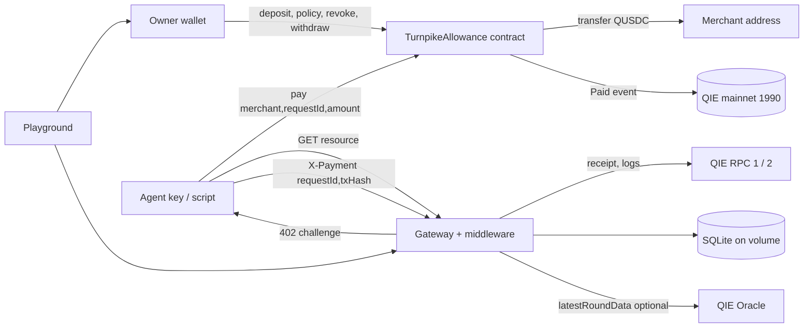
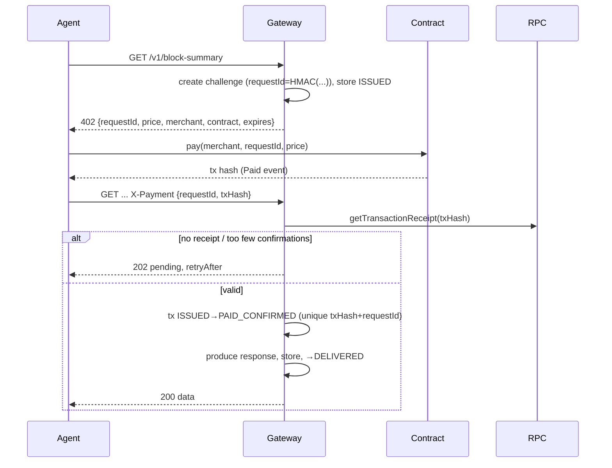
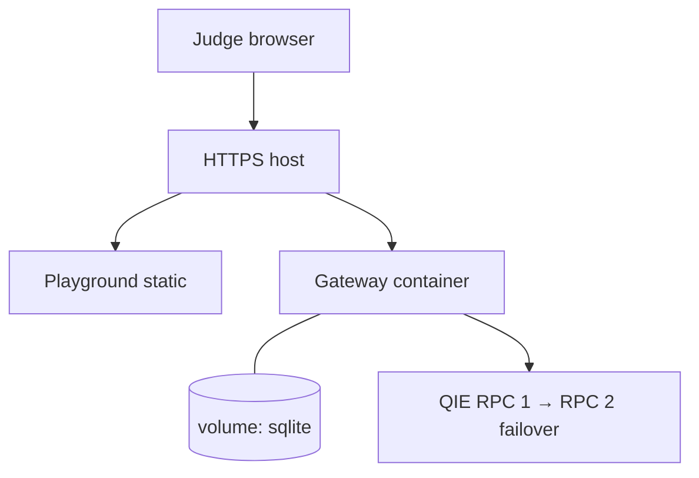

# 05 — System Architecture

## 1. Components

## 2. Responsibilities
| Component | Does | Never does |
|---|---|---|
| Contract | Holds owner balances, enforces policy, consumes requestIds, emits `Paid` | trust the gateway; hold admin power; be upgradeable |
| Gateway | Issues signed challenges, verifies on-chain proof, delivers once, records state | hold user funds; sign on-chain transactions |
| Agent | Signs `pay` transactions within policy | change policy, withdraw |
| Playground | UX for owner and demo | store keys server-side |

## 3. Payment sequence

## 4. requestId construction
`requestId = keccak256(abi.encode(nonce, merchant, resourceId, price, chainId, contract, expiry))` is the identifier; the gateway also returns `sig = HMAC-SHA256(secret, canonical fields)`. On presentation the gateway recomputes the HMAC and checks expiry, resource and price against the stored row. On-chain, the contract only sees `requestId` (opaque bytes32) and records `(merchant, requestId)` as used. Binding to merchant/resource/amount happens server-side and in the key `(merchant, requestId)`; the contract cannot know the resource, so cross-resource crediting is prevented by the gateway row (SEC-003).

## 5. Payment ↔ delivery consistency (amendment 4)
State machine in `payments` table, unique on `requestId`:
| State | Meaning | Transition trigger |
|---|---|---|
| ISSUED | challenge created, unpaid | challenge request |
| PAID_PENDING | proof submitted; receipt absent/under-confirmed | proof request |
| PAID_CONFIRMED | log verified; txHash recorded; resource locked to this row | verification passes (single SQLite transaction, `txHash` UNIQUE) |
| DELIVERED | response body (or hash + regenerable flag) stored | handler success |
| EXPIRED / REJECTED | terminal failures | TTL / verification fail |

Relationships: signed requestId → one `payments` row → one on-chain `used[(merchant,requestId)]` flag → one `Paid` log in one receipt (txHash). Same proof again: row is `DELIVERED` → return stored result (idempotent). Different resource with same proof: row's `resourceId` mismatch → 403.

**Crash recovery.** Payment succeeded, gateway died before delivery: row is `PAID_PENDING` or `PAID_CONFIRMED`. On retry with the same proof (agent keeps `{requestId, txHash}`), the gateway re-verifies (or finds `PAID_CONFIRMED`), runs the handler, stores, and delivers. If the agent lost the proof but the tx is known on-chain, the gateway offers `GET /v1/payments/{requestId}` (read-only status; delivers only on the same resource request). Nothing is ever charged twice because the on-chain used-flag blocks a second `pay` with the same requestId and a new challenge needs a new payment by design. Stale `PAID_CONFIRMED` rows beyond a recovery window (24 h) are listed on the evidence page as "paid, undelivered" and are not auto-refunded (no refund mechanism in MVP; documented limitation L-2).

## 6. Oracle failure
Probe before challenge (FR-018); returned data always carries `updatedAt` and `decimals`; no cached fallback value is invented.

## 7. Deployment

