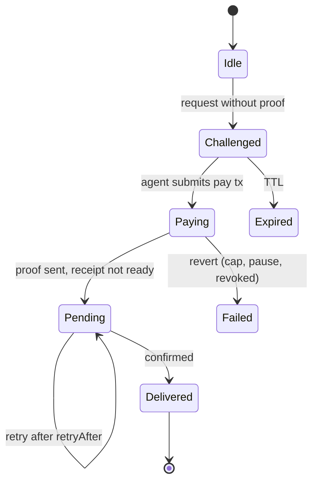

# 07 — User Experience and Flows

## 1. Journeys
| ID | Journey | Steps |
|---|---|---|
| UX-1 | Owner setup | connect wallet (chain 1990) → approve QUSDC → deposit → set agent address, per-call cap, daily cap → allowlist merchant |
| UX-2 | Agent paid call | agent requests resource → gets 402 → pays → retries with proof → data |
| UX-3 | Refused call | agent exceeds per-call cap → on-chain revert shown with explorer link |
| UX-4 | Replay | same proof/requestId reused → refused (on-chain `RequestAlreadyUsed`, gateway idempotent) |
| UX-5 | Revoke / pause / withdraw | owner revokes → next agent call reverts; owner pauses → pay reverts, withdraw works; owner withdraws remainder |
| UX-6 | Seller integration | developer reads README, adds middleware, sets price table |

## 2. Playground screens
1. **Wallet & balance**: network indicator, deposit/withdraw.
2. **Policy**: per-call, daily, agent, merchants, pause, revoke.
3. **Run agent**: buttons for scripted scenarios (allowed, over-cap, replay, after-revoke), live log with tx links.
4. **Evidence**: contract link, verified status, usage counters (own vs external).

## 3. UX rules
- Show "Pending (waiting for confirmations)" with elapsed seconds; never imply instant settlement (NFR-001).
- Every on-chain action displays an explorer link.
- Amounts always shown as QUSDC with 6 decimals; base units in tooltips (avoid 100,000 = 1 QUSDC error).
- Error mapping: custom errors → human text (`CapExceeded` → "Over the per-call limit").
- Cost disclosure: gas in QIE shown before sending.
- Empty/error states: RPC down banner, wrong-network prompt, oracle unavailable message.
- Accessibility: keyboard navigation, contrast, no colour-only status.

## 4. Failure behaviours
| Case | UI |
|---|---|
| Wrong chain | block actions, offer switch |
| Insufficient QIE for gas | message with balance |
| Receipt slow >60 s | keep pending, show txHash, allow manual recheck |
| Gateway restarted | status page shows prior state from DB |
