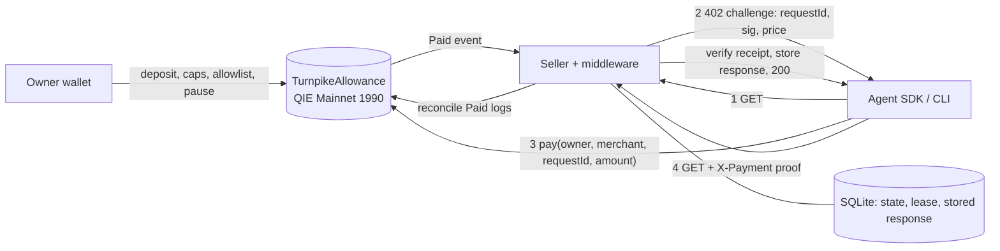
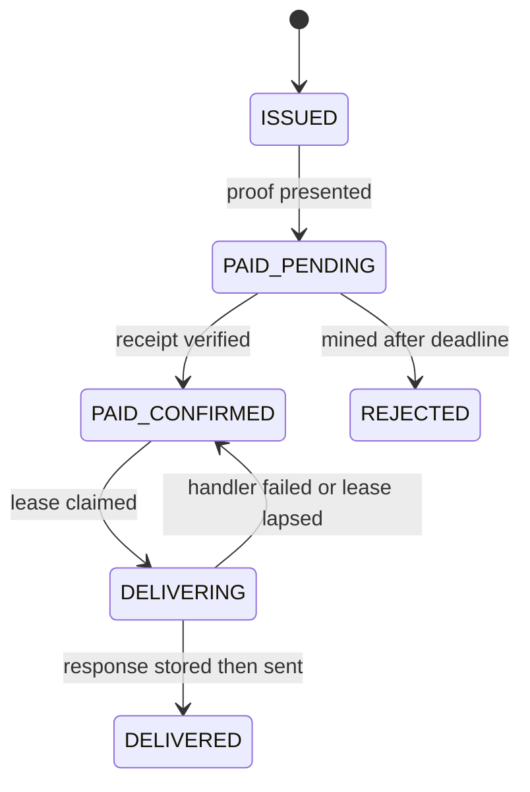

# Submission package: QIE Hackathon 3.0

**Nothing has been submitted. No external user exists. The video is a live screen recording (`video/README.md`).** This folder is a set of drafts for the owner to edit, approve and act on.

Contents: this file (description, architecture, checklist, approvals) · [APPLICATION.md](APPLICATION.md) (form copy) · [FOUNDER_DECISIONS.md](FOUNDER_DECISIONS.md) (decisions in the owner's voice, unsigned) · [OWNER_TASKS.md](OWNER_TASKS.md) (work only the owner can do) · [PITCH_AND_QA.md](PITCH_AND_QA.md) (pitch outline, judge Q&A) · [DEMO_VIDEO.md](DEMO_VIDEO.md) (pointer) · [video/](video/) (the video, its hash and upload text) · [presentation/](presentation/) (slides) · [../DEVELOPER_ONBOARDING.md](../DEVELOPER_ONBOARDING.md) · [../DIFFERENTIATION.md](../DIFFERENTIATION.md) · [../OWNER_DECISIONS.md](../OWNER_DECISIONS.md) · [../CODEBASE_REVIEW.md](../CODEBASE_REVIEW.md).

## Official requirements (read live on hackathon.qie.digital and /terms, 2026-11-24; these take precedence over the starter pack)
- Deadline: **23:59 CET, 30 November 2026**. Mainnet only. (An older line in `docs/12` said 18:00 CET; it was wrong and is corrected.)
- Submit through the form after signing in: GitHub repository, live demo URL, deployed mainnet contract address, one track. Terms also ask for a working demo, comprehensive documentation, original work made during the period, and QIE integration.
- Tracks: DeFi & Financial Infrastructure; AI + Autonomous Agents; Consumer Apps & Social; Commerce & Real World; Developer Infrastructure & Tooling.
- **Mandatory items in the official FAQ:** mainnet deployment, open-source smart contracts, live public app, public repository, **demo video**, documentation and a **team presentation**. Draft slides: `presentation/`.
- **The two official weightings disagree.** Terms (last updated 11/18/2026): innovation 25, technical implementation 25, impact 25, presentation 25. FAQ on the home page: innovation 30, technical quality 25, user experience 15, mainnet integration 15, business potential 15. Prepare for both; only the organisers can say which applies (info@qie.digital).
- **AI assistance:** the FAQ says it is encouraged, and that teams must understand, maintain and be able to explain their code. The rules list "AI-generated projects" with minimal developer contribution as a disqualifying violation. Demo week with live judging is 1 to 5 December. Extra consideration for integrating several QIE components (QIE Wallet, QIE ID, QIEDEX, Oracles); this release adds an optional, display-only QIE ID lookup and none of the others.
- **No video length limit is stated** on either page. We target 2 minutes anyway. Re-check the form itself.
- Zero tolerance: "AI-Generated Projects" with minimal developer contribution. The disclosure is in `docs/HUMAN_REVIEW_LOG.md`.
- From the starter pack we use: a README that explains problem, solution and how to run; a short demo video; screenshots; a pitch outline. Where it conflicts with the official pages, the official pages win.

## Project description
The final form copy is in [APPLICATION.md](APPLICATION.md) (track: AI + Autonomous Agents, as proposed by the owner).

## Problem, solution, audience
- **Problem:** agents that call paid APIs hold keys that can spend without a hard ceiling; sellers who want per-request payment must build verification, replay protection and crash recovery themselves.
- **Solution:** contract-enforced owner limits plus a request-bound, recoverable payment flow behind a one-line middleware, a client SDK and a CLI.
- **Audience:** (1) API providers who want to charge per call; (2) developers and operators running agents that must stay inside a budget.
- **Honest differentiation:** see `docs/DIFFERENTIATION.md`. The claim is the integrated combination, not any one ingredient; not x402-compatible; no external users yet; the owner proposes PASS and has not yet signed it.

## Architecture

## Screenshots (captured 2026-11-19 from the deployed site)
`docs/screenshots/`: `home-desktop.png`, `product-desktop.png`, `developers-desktop.png`, `playground-desktop.png`, `app-desktop.png`, `evidence-desktop.png`, `security-desktop.png`, `about-desktop.png`. Desktop width 1440 only; a mobile layout was verified by script, not saved as an image.

## Official submission checklist (owner ticks; none ticked here; details in OWNER_TASKS.md)
- [ ] Re-read live Terms and the submission form (last updated date seen: 11/18/2026)
- [ ] Track chosen (D5)
- [ ] Mainnet contract address entered: `0xa2f2e042861a593cc582c6d2d43a24457dcf5d9c`; explorer source verified
- [ ] Repository public with README, docs, LICENSE; branch merged to `main`
- [ ] Live demo URL tested from a clean browser: https://turnspike-qie.vercel.app
- [ ] Differentiation PASS/FAIL decided (D1)
- [ ] Demo video approved (`video/README.md`) and uploaded by the owner
- [ ] Human review log filled in by the owner with real entries
- [ ] Eligibility items confirmed by the owner (18+, QIE wallet, not QIE affiliate, verified email)
- [ ] One submission per team
- [ ] Package versions in the form match the registry: middleware 0.1.0, client 0.1.1, CLI 0.1.1 (published 2026-11-19)
- [ ] Founder decisions signed (`FOUNDER_DECISIONS.md`)

## Register of actions that need the owner's approval (none recorded as approved)
| Action | Recommendation | Flags |
|---|---|---|
| Choose track | AI + Autonomous Agents (owner's proposal) | P |
| Tick differentiation PASS | PASS on combination claim, after reading sources | P |
| Publish client and CLI 0.1.1 | done 2026-11-19 with the owner's passkey (CLI published by the owner from their PC) | P I |
| Merge and deploy the pre-submission fixes (D12) | yes | P |
| Refresh the Cloudflare standby, payments off (D11) | yes | K |
| Approve and upload the video | after watching it | P |
| Submit the form | by 30 Nov 23:59 CET, leave a day of margin | P |
| Fund demo wallets or run a new paid recording | only if needed | $ |
| Rotate demo agent key | after judging | K |
| Delete Fly app `turnpike-qie` | after 10 Dec | I |
