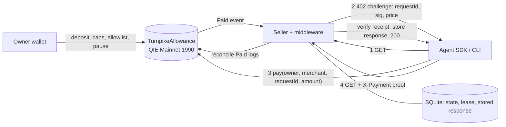
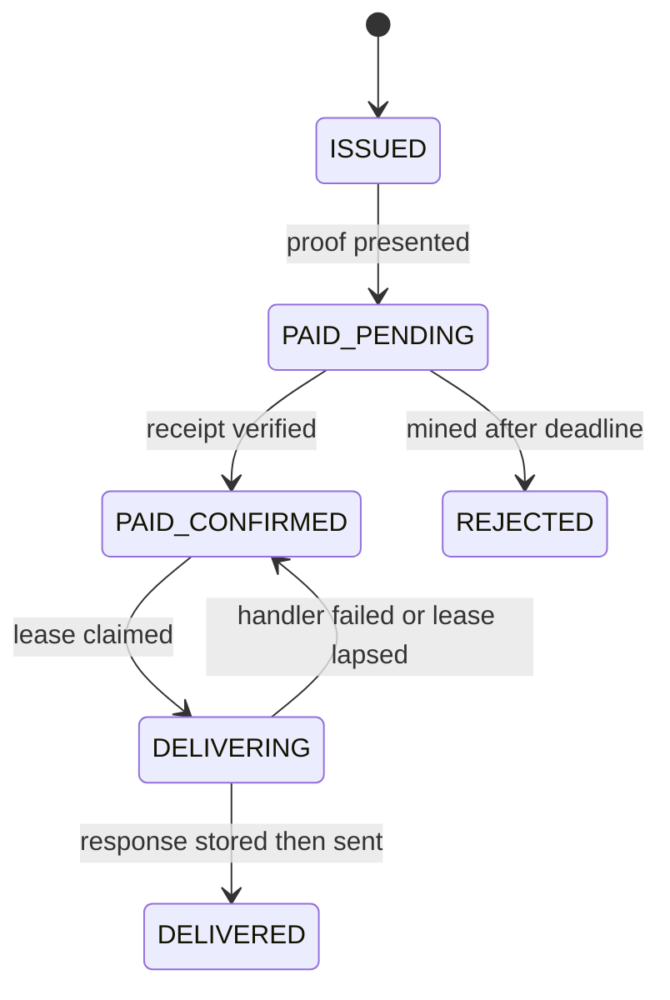

# Submission package: QIE Hackathon 3.0

**Nothing has been submitted. No video has been recorded. No external user exists.** This folder is a set of drafts for the owner to edit, approve and act on.

Contents: this file (description, architecture, checklist, approvals) · [DEMO_VIDEO.md](DEMO_VIDEO.md) (script, shot list, fallback) · [PITCH_AND_QA.md](PITCH_AND_QA.md) (deck outline, judge Q&A) · [../DEVELOPER_ONBOARDING.md](../DEVELOPER_ONBOARDING.md) · [../DIFFERENTIATION.md](../DIFFERENTIATION.md) · [../OWNER_DECISIONS.md](../OWNER_DECISIONS.md) · [../CODEBASE_REVIEW.md](../CODEBASE_REVIEW.md).

## Official requirements (checked live on hackathon.qie.digital and /terms, 2026-11-19; these take precedence over the starter pack)
- Deadline: **23:59 CET, 30 November 2026**. Mainnet only. (An older line in `docs/12` said 18:00 CET; it was wrong and is corrected.)
- Submit through the form after signing in: GitHub repository, live demo URL, deployed mainnet contract address, one track. Terms also ask for a working demo, comprehensive documentation, original work made during the period, and QIE integration.
- Tracks: DeFi & Financial Infrastructure; AI + Autonomous Agents; Consumer Apps & Social; Commerce & Real World; Developer Infrastructure & Tooling.
- Judging criteria: Originality & Innovation; Real-World Usefulness; Product Quality & UX; QIE Ecosystem Integration; User Adoption Potential. Weights were not retrievable. Extra consideration for integrating several QIE components (QIE Wallet, QIE ID, QIEDEX, Oracles); we integrate none of those.
- **No video length limit is stated** on either page. We target 2 minutes anyway. Re-check the form itself.
- Zero tolerance: "AI-Generated Projects" with minimal developer contribution. The disclosure is in `docs/HUMAN_REVIEW_LOG.md`.
- From the starter pack we use: a README that explains problem, solution and how to run; a short demo video; screenshots; a pitch outline. Where it conflicts with the official pages, the official pages win.

## Project description (draft, about 100 words)
Turnspike lets any API charge per request in QUSDC on QIE Mainnet, and lets the person who funds an AI agent keep enforceable limits on what it can spend. An API provider mounts one Express middleware and names a price. The agent's SDK or the `turnspike` CLI pays through a settlement contract that checks the owner's per-call cap, daily cap, merchant allowlist and pause switch inside the payment transaction itself. The seller verifies the receipt, stores the response before sending it, and replays it on retry, so a crash does not lose a payment. Unaudited; small amounts only.

## Problem, solution, audience
- **Problem:** agents that call paid APIs hold keys that can spend without a hard ceiling; sellers who want per-request payment must build verification, replay protection and crash recovery themselves.
- **Solution:** contract-enforced owner limits plus a request-bound, recoverable payment flow behind a one-line middleware, a client SDK and a CLI.
- **Audience:** (1) API providers who want to charge per call; (2) developers and operators running agents that must stay inside a budget.
- **Honest differentiation:** see `docs/DIFFERENTIATION.md`. The claim is the integrated combination, not any one ingredient; not x402-compatible; no external users yet; the owner's PASS/FAIL is pending.

## Architecture

## Screenshots (captured 2026-11-19 from the deployed site)
`docs/screenshots/`: `home-desktop.png`, `product-desktop.png`, `developers-desktop.png`, `playground-desktop.png`, `app-desktop.png`, `evidence-desktop.png`, `security-desktop.png`, `about-desktop.png`. Desktop width 1440 only; a mobile layout was verified by script, not saved as an image.

## Official submission checklist (owner ticks; none ticked here)
- [ ] Re-read live Terms and the submission form (last updated date seen: 11/18/2026)
- [ ] Track chosen (D5)
- [ ] Mainnet contract address entered: `0xa2f2e042861a593cc582c6d2d43a24457dcf5d9c`; explorer source verified
- [ ] Repository public with README, docs, LICENSE; branch merged to `main`
- [ ] Live demo URL tested from a clean browser: https://turnspike-qie.vercel.app
- [ ] Differentiation PASS/FAIL decided (D1)
- [ ] Demo video recorded (see DEMO_VIDEO.md) and uploaded
- [ ] Human review log filled in by the owner with real entries
- [ ] Eligibility items confirmed by the owner (18+, QIE wallet, not QIE affiliate, verified email)
- [ ] One submission per team
- [ ] Client 0.1.1 published if desired (D4)

## Register of actions that need the owner's approval (none recorded as approved)
| Action | Recommendation | Flags |
|---|---|---|
| Choose track | AI + Autonomous Agents | P |
| Tick differentiation PASS | PASS on combination claim, after reading sources | P |
| Publish client 0.1.1 | yes, after merge and tests | P I |
| Merge this branch to main | yes after reading the diff | |
| Record and upload video | yes, using the script | P |
| Submit the form | by 30 Nov 23:59 CET, leave a day of margin | P |
| Fund demo wallets or run a new paid recording | only if needed | $ |
| Rotate demo agent key | after judging | K |
| Delete Fly app `turnpike-qie` | after 10 Dec | I |
