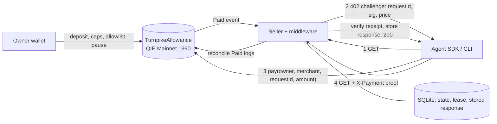
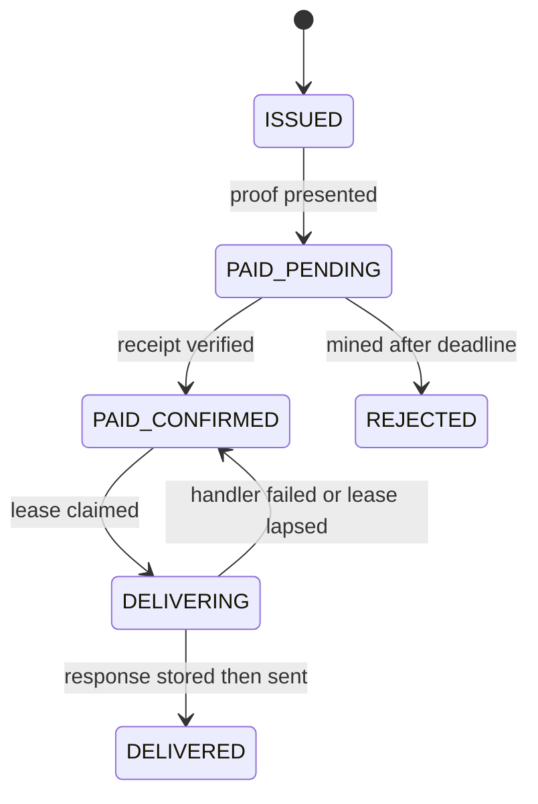

# Turnspike: QIE Hackathon 3.0 materials

Turnspike lets AI agents pay per request for APIs in QUSDC on QIE Mainnet, inside spending limits their owner sets on chain. This folder collects the submission materials. **Status: not yet submitted.** Nothing here records a submission, a signature or an eligibility confirmation.

| | |
|---|---|
| Live app | https://turnspike-qie.vercel.app |
| Contract (QIE Mainnet, chain 1990) | [`0xa2f2e042861a593cc582c6d2d43a24457dcf5d9c`](https://mainnet.qie.digital/address/0xa2f2e042861a593cc582c6d2d43a24457dcf5d9c#code), source verified on the explorer |
| Token | QUSDC `0x3F43DA82eC9A4f5285F10FaF1F26EcA7319E5DA5` |
| Track | AI + Autonomous Agents (proposed) |
| npm | `@turnspike-qie/middleware` 0.1.1, `client` 0.1.1, `cli` 0.1.1, `mcp` 0.1.0 |

## Read in this order
1. **What it does and how it works:** [../../README.md](../../README.md), [../PROTOCOL.md](../PROTOCOL.md), [../05_SYSTEM_ARCHITECTURE.md](../05_SYSTEM_ARCHITECTURE.md)
2. **How to use it:** [../DEVELOPER_ONBOARDING.md](../DEVELOPER_ONBOARDING.md), and https://turnspike-qie.vercel.app/developers
3. **Mainnet evidence:** [../../evidence/](../../evidence/), notably [M10, a live purchase](../../evidence/M10_live_purchase_2026-11-24.md), [M11, an owner cycle](../../evidence/M11_owner_cycle_2026-11-24.md) and [M9, deployed bytecode verification](../../evidence/M9_deployed_bytecode_verification.md)
4. **Security and limits:** [../08_SECURITY_PRIVACY_AND_TRUST.md](../08_SECURITY_PRIVACY_AND_TRUST.md), [../CODEBASE_REVIEW.md](../CODEBASE_REVIEW.md), [../RELEASE_QA.md](../RELEASE_QA.md)
5. **Demo and presentation:** [video/README.md](video/README.md) (the submission video, 24 November 2026), [presentation/](presentation/) (slides, PDF and PowerPoint)
6. **Submission text:** [APPLICATION.md](APPLICATION.md)
7. **How it was built:** [../HUMAN_REVIEW_LOG.md](../HUMAN_REVIEW_LOG.md) (AI assistance and the owner's own work), [../DIFFERENTIATION.md](../DIFFERENTIATION.md), [../OWNER_DECISIONS.md](../OWNER_DECISIONS.md), [../CHANGELOG.md](../CHANGELOG.md)

## Known limits, stated plainly
- The contract is unaudited. Use small amounts.
- No developer or merchant outside the project has used it yet. Every payment so far is the project's own.
- Not x402-compatible; no x402 support is claimed.
- The payment gateway runs on Fly; a Cloudflare copy is on standby with payments off. The hosted MCP server is read-only.
- An AI coding assistant wrote the first version of most of the code and documentation; see [../HUMAN_REVIEW_LOG.md](../HUMAN_REVIEW_LOG.md).

## Architecture

## Screenshots
[`../screenshots/`](../screenshots/), captured 19 November 2026 from the deployed site at 1440 px wide.
